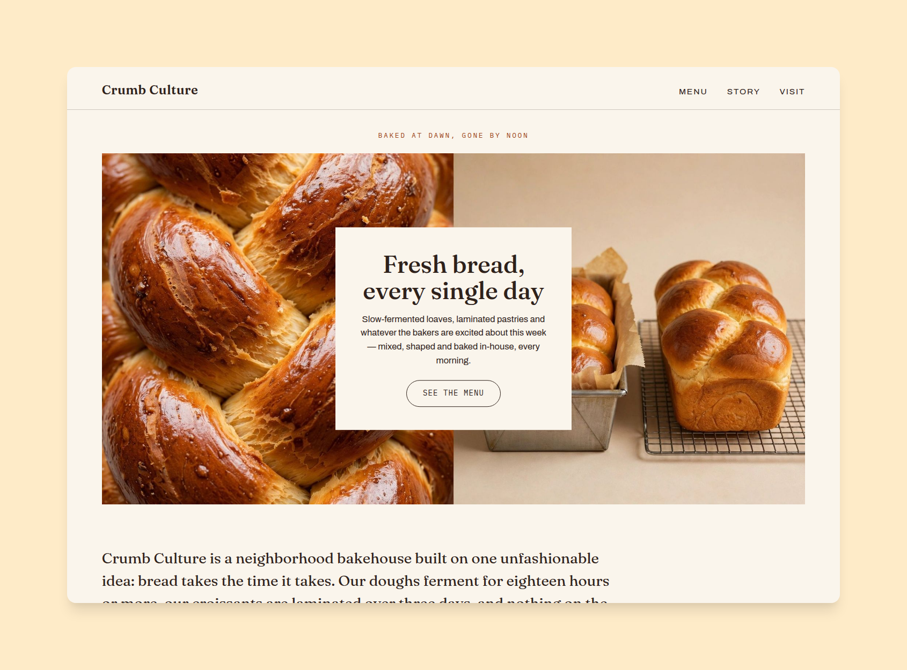

# Crumb Culture — an artisan bakehouse template

A warm, editorial website template for a bakery, bakehouse or cafe —
built with [Astro](https://astro.build) 7 and deployed with
[SST](https://sst.dev) v3 to S3 + CloudFront. The design is a cream
ground with dark espresso serif type (Fraunces), a burnt-crust accent,
and a signature **50/50 split hero**: two photographs side by side with a
cream card laid over the seam. Everything — menu, prices, hours, story,
colors, fonts — is driven by **one config file**, so a bakery owner can
make it theirs without touching code.



**Live preview:** https://ctrimm.github.io/crumb-culture/

## Make it yours

Edit **`site.config.ts`** — that is the only file you need. It holds:

- the bakehouse name, email, location and socials,
- the palette (hex colors) and font preset,
- the split-hero photos and the card that sits on them,
- the bakes (title, category, **price**, bake days, photo, details) —
  the home page, the Menu page and each bake's own page are all
  generated from this list,
- opening hours, address and good-to-know notes for the Visit page,
- the story, principles, services and stockist list.

The build validates the config and stops with a plain-language message
if something is wrong (a malformed email, a missing photo path, two
bakes with the same slug, …).

Photos live in `public/images/`. After swapping any photo, regenerate
its responsive sizes with:

```bash
python3 scripts/optimize-images.py   # needs Pillow
```

## Pages

| Route | What it is |
| --- | --- |
| `/` | Split hero + card, philosophy & stats, services index, featured bakes, a bake day hour by hour, stockists |
| `/menu` | Every bake grouped by category with prices, the bake schedule, subscriptions/wholesale detail |
| `/story` | The bakehouse story, principles and availability |
| `/visit` | Photo, address, opening hours, notes and contact email |
| `/<bake-slug>` | One page per bake: story, details and a next-bake link |

## Develop

```bash
npm install
npm run dev        # local preview
npm test           # unit + integration (builds the site)
npm run test:e2e   # Playwright against the production build
npm run grade      # Lighthouse: accessibility / best practices / SEO gates
```

## Deploy

GitHub Pages preview: pushes to `main` run CI (tests + end-to-end) and
deploy the site to `https://<owner>.github.io/crumb-culture/` — the
build handles the subpath automatically.

Production is SST (the repo owner's step):

```bash
npm run deploy     # sst deploy — S3 + CloudFront
```

## AI readiness

- `/llms.txt` — a plain-language map of the site, generated from the config
- Bakery JSON-LD structured data in every page head
- `/sitemap.xml` — generated from the page + bake list
- `robots.txt` that explicitly welcomes AI crawlers

## Design notes

- Fonts are **self-hosted** (Fraunces, Archivo, IBM Plex Mono) — no
  third-party requests.
- The palette is contrast-tested in the unit suite: body text, prices
  and labels all meet WCAG AA on the grounds they sit on.
- Scroll-reveal animations never fade opacity (a half-faded element is
  a half-blended color and fails contrast audits); hidden means
  `visibility: hidden`, and content is visible by default if JS fails.
- All photography in the demo is AI-generated for the fictional
  Crumb Culture Bakehouse (Austin, Texas) and lives in `source-images/`
  before slicing/optimization.
